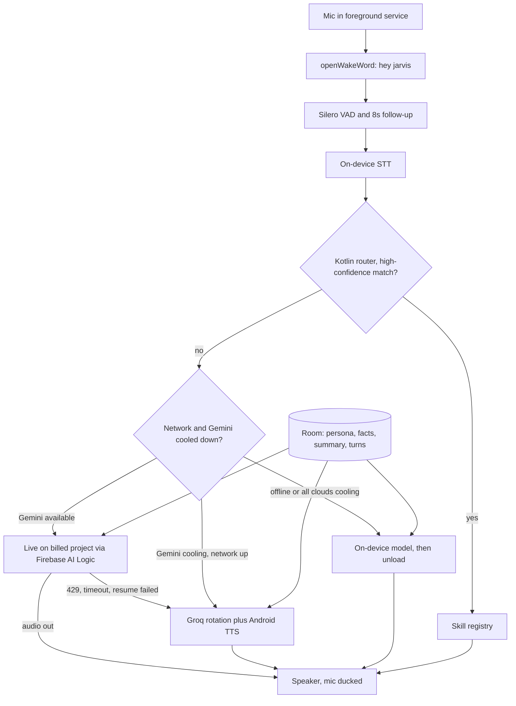

# Jarvis S10 build plan

Source: Grok CLI review of 23/10/2026 (below), plus Mahmoud's fixed decisions.

## Fixed decisions (Mahmoud)
- Fully on the Galaxy S10 (Android 12, API 31, Snapdragon 855 / Exynos 9820). No Mac or backend at runtime.
- Brain fallback chain: (1) Kotlin command router on the phone, (2) Gemini Live API via Firebase AI Logic + App Check (model gemini-3.1-flash-live-preview; gemini-3.8-live is NOT available through Firebase), (3) Groq backup (openai/gpt-oss-120b, qwen/qwen3.8-27b, openai/gpt-oss-20b; whisper-large-v3-turbo as backup STT) through a proxy placeholder, (4) on-device Gemma (MediaPipe or llama.cpp). Gemini Nano does not run on the S10.
- Voice: openWakeWord "hey jarvis", Silero VAD, mute/echo cancellation while speaking, follow-up window. Android TTS for replies outside Live.
- Shell: Jetpack Compose, kiosk mode, true black, burn-in protection, 85% charge cap set manually.
- Camera: streamed over the LAN only.
- UI: "AI cloud of dots" (see docs/jarvis-ui.html), implemented natively with OpenGL ES 3 in a GLSurfaceView. States: idle, listening, thinking, speaking, error/offline. Brain accent colors: Phone #3fd8ff, Gemini #8c73ff, Groq #ff9e40, Offline #73808c.
- Persona/memory/skills: editable "About Mahmoud" persona prompt; Room memory (facts + rolling summary + recent turns); skills registry with one uniform Kotlin interface; optional Telegram channel later.
- Secrets: NEVER commit real keys. local.properties entries GEMINI_*/GROQ_* left empty; google-services.json is NOT in the repo (Mahmoud adds his own Firebase project).

## Grok's detailed plan
The decisions hold. Build a foreground kiosk on the S10: the Kotlin router owns actions, Gemini Live owns conversation, Groq and a cold on-device model are backups. The Mac split from the previous review is retired.

## 1. Verdict

This matches an S10. Wake word, VAD, routing, tools, memory, TTS, and the orb stay on the phone. Only open questions cross the network. The router is what makes free tiers survivable.

### Where I disagree

1. **Free tier, then $10 credits, will not stack on one project.** Linking an active billing account moves that project to Tier 1, usually immediately. Plan on two AI Studio projects: Project F with no billing, Project P with the prepaid deposit and the monthly credits. Live runs only on P.
2. **Free-tier audio should not carry the room.** Free-tier content is used to improve Google products. Paid-tier content is not. Live audio includes other people and the TV. Project F, if used at all, receives text of a completed utterance. Live stays on P.
3. **Firebase cannot host `gemini-3.8-live`.** Firebase AI Logic’s 3.x Live model is `gemini-3.1-flash-live-preview`, plus the 2.5 native-audio previews. That is the main Live id. `gemini-3.8-live` would need a raw developer key or a proxy, which drops the App Check property.
4. **The on-device model is a last resort, loaded on demand, then unloaded.** A 1B–2B quant on this phone is slow and warm. It does not receive the tool list. Tools stay in Kotlin and already run offline.
5. **Groq Whisper should not sit in front of the router.** A network STT makes “set a timer” slow and spends the 2,000/day Whisper cap on commands. On-device STT first. Whisper when that recognizer fails and the next brain is cloud text.
6. **Weather uses a saved home lat/lon** from the profile. A desk kiosk does not need a GPS watch.

## 2. Final architecture

The activity stays visible with `FLAG_KEEP_SCREEN_ON` and a foreground service of type `microphone`. Android 12 allows the mic while that service is in the foreground. Lock-task keeps it on top.



Live is opened only after the router misses. PCM captured during on-device STT is the start of the Live uplink, then the live mic follows. `contextWindowCompression` with a sliding window stays on. The socket closes when the follow-up window ends so idle audio is not streamed. On `GoAway` (~60s before the ~10 min connection cap), reconnect once with the resumption handle (valid 2 hours).

Non-Live turns use the same skills through function calls. Live has function calling and Search grounding. It has no JSON mode and no token-count API, so the phone trims the prompt itself.

## 3. Component list

Verify every version on the day you add it. Coordinates only, no invented versions.

| Piece | Artifact |
| --- | --- |
| UI | `androidx.compose:compose-bom`, `androidx.activity:activity-compose` |
| Gemini | Firebase BoM, `com.google.firebase:firebase-ai` (older docs say `firebase-vertexai`) |
| App Check | `firebase-appcheck-playintegrity`; `firebase-appcheck-debug` in `debugImplementation` only |
| HTTP | `com.squareup.okhttp3:okhttp`. Redact `Authorization` in any logger |
| Wake word + VAD | `com.microsoft.onnxruntime:onnxruntime-android`. openWakeWord ONNX files (`melspectrogram`, embedding, `hey_jarvis`) and Silero VAD ONNX. Confirm filenames and the VAD window (v5 is 512 samples at 16 kHz) |
| Memory | `androidx.room:room-runtime`, `room-ktx`, KSP compiler |
| JSON | `kotlinx-serialization-json` |
| Camera | `androidx.camera:camera-core`, `camera-camera2`, `camera-lifecycle` |
| Local LLM | `com.google.mediapipe:tasks-genai` first. If no Gemma build fits API 31 in free RAM, llama.cpp built with the NDK. No canonical Maven coordinate for that |
| Timers, torch, calendar, TTS | Framework: `AlarmManager`, `CameraManager.setTorchMode`, `CalendarContract`, `TextToSpeech` |
| Weather | Open-Meteo HTTPS, no key, coordinates from the profile |
| MJPEG | A small `ServerSocket` bound to the Wi-Fi address. Skip a server framework |

Model ids live in one config object: Live `gemini-3.1-flash-live-preview`; text fallback `gemini-3.1-flash-lite` (verify it is in the Firebase list); Groq `openai/gpt-oss-120b`, `qwen/qwen3.8-27b`, `openai/gpt-oss-20b`; Whisper `whisper-large-v3-turbo`. Groq ids are your console reading and were not re-verified.

Audio formats: Live in is 16-bit PCM 16 kHz; Live out is 16-bit PCM 24 kHz. Enable `AcousticEchoCanceler` on the record session when `create()` is non-null. While Android TTS or Groq audio plays, mute the uplink. During Live, duck the uplink when playback RMS is high if hardware AEC is missing.

## 4. Provider-fallback logic

Shared Room store, tagged by channel (`voice` or later `telegram`):

- Persona, edited in app, capped at about 2,000 characters.
- Facts, written by a `remember` skill, not by a separate summarizer call.
- One rolling summary, a few hundred tokens.
- Last turns, verbatim.

Every provider gets `fit(persona, facts, summary, turns, charBudget)`. Estimate tokens as chars/4. Budgets: Live system text ~3,000 chars, Gemini text ~6,000, Groq ~4,500 (about 1,200–1,500 tokens so one turn fits in 8K TPM), local ~2,000. The local transcript is the source of truth across fallbacks. A Live session is not exportable history.

```kotlin
suspend fun reply(turn: Utterance): Answer {
  skillRegistry.match(turn.text)?.let { return it.run(turn) } // offline, no cloud
  if (!net.up) return localOrRefuse()
  if (!gemini.cooling) {
    val result = runCatching { gemini.liveOrText(turn, memory.fitForGemini()) }
    when (val e = result.exceptionOrNull()) {
      null -> return result.getOrThrow().also { memory.append(it) }
      is Quota -> gemini.cool(e)          // else fall through
      is Timeout, is SocketDrop ->
        if (gemini.resumeOnce(e)) return gemini.current()
    }
  }
  val model = groq.nextHealthy() ?: return localOrRefuse()
  return groq.complete(model, memory.fitForGroq(turn))
    .also { memory.append(it) }
    .recover { groq.cool(model, it); reply(turn) } // rotates; stops when all cool
}
```

Switch rules:

- **Gemini 429 or `RESOURCE_EXHAUSTED`.** Honor `Retry-After`. Daily-cap wording cools Gemini until 00:00 `America/Los_Angeles`. RPM-style cools 60s plus jitter. This utterance goes to Groq.
- **First audio or token later than 8s.** One retry, then Groq.
- **Live `GoAway` or socket drop.** Resume once with the handle. Second failure goes to Groq. Compression stays on so a long talk is not cut at 15 minutes of audio.
- **Groq 429 or 8K TPM.** Cool that model only. Rotate to the next id. Persist the index so restarts share the 200K TPD.
- **All three Groq models cooling, or offline.** Load the local model, answer without tools, unload after 60s idle. If it is missing, speak one sentence that router skills still work.
- **Next wake.** Try Gemini again unless its cooldown is still running. Stay on the fallback only for the current utterance.

Client counters, since Live returns no `UsageMetadata`: count Live sessions and wall-clock seconds, Gemini requests, and Groq tokens per model. Stop Live at a configured daily turn cap. Stop each Groq model at about 180K of its 200K TPD. Reset Gemini counters at midnight Pacific. Groq’s reset is whatever the console shows; until you confirm it, use a rolling 24h on-device.

## 5. Daily budget estimate

Assumptions: one person; the router absorbs commands; a cloud turn is an open question. Live price used is the verified 23/10/2026 rate that includes `gemini-3.1-flash-live-preview`: audio in $0.005/min, audio out $0.018/min. Your speech example is 20s in + 15s out. A second row bills the whole open socket, because silence you uplink is still audio.

| Path | Assumption | Turns |
| --- | --- | --- |
| Gemini free | No public RPM/RPD. Read AI Studio for Project F and set the client cap to that number. Design so a day still works if this cap is small | Unknown until you read the console. Treat it as bonus text capacity, not the planner |
| Live, speech only | $0.00167 in + $0.0045 out = **$0.00617**. Add ~800 system tokens ($0.0006) → **~$0.0068** | **~$10 / $0.0068 ≈ 1,470/month ≈ 49/day** |
| Live, 45s socket + 15s reply | In $0.00375 + out $0.0045 + system text | **~$40/day** on $10, closer to 30 if sessions run long |
| Gemini text, `gemini-3.1-flash-lite` paid | 1,500 in + 300 out ≈ **$0.00083** | Thousands per $10. Use this once the Live daily cap is hit |
| Groq chat, three models | 1,450 tokens/turn, limits independent, TPD binds before 1,000 RPD | **~138 turns per model, ~410/day** if rotation is even. A 6K prompt drops that to ~30/model |
| Groq Whisper | 2,000 RPD and 28,800 audio-seconds | Not the limit for one person if it is the backup STT |

Tier 1’s $10 per 10 minutes spend cap is far above this. Search grounding’s 5,000 free/month on paid covers a desk assistant; past that it is $14 per 1,000. Default the app to about 40 Live turns/day so a long session does not eat the month. Orpheus at 100/day stays off the main path. Arabic on Live audio models is `ar-EG` only.

## 6. Key security

**Gemini.** Firebase AI Logic, no Gemini key in the APK. The `google-services.json` key is not a secret; restrict it to this package and signing cert. App Check is the real gate.

Play Integrity on a pure sideload often fails app recognition. The S10 path that works: create the app in Play Console, upload the same signing cert to an **internal testing** track, install that build, use the Play Integrity provider. Ship `firebase-appcheck-debug` only in debug builds, with one debug token registered for this phone while developing. A release APK that uses the debug provider is a shared secret; anyone with the APK can mint tokens.

**Groq.** There is no App Check equivalent. Embedding the key in `BuildConfig` or the APK is extractable with `apktool`.

Recommendation: a **Cloudflare Worker** holds `GROQ_API_KEY` as a secret and forwards only the three chat ids plus Whisper. The phone authenticates with a long random bearer stored in the Android Keystore (pasted once, never in git). The worker rate-limits to your daily caps and can be revoked without a new APK. At this volume the Worker free tier covers it, and the extra hop is tens of milliseconds. The worker sees the same text Groq would see.

Acceptable alternative for a phone that never shares the APK: Keystore only, no proxy, OkHttp pinned to `api.groq.com`, client-side caps. Residual risk is a lost phone, a backup, or malware on that device draining the org until you revoke the key in the Groq console. Skip NDK obfuscation. It does not hold up.

Use the same Keystore pattern later for a Telegram bot token, or put that token in the worker too.

## 7. Project structure

Six Gradle modules. Skills are packages behind one interface, not a module per tool.

```text
:app                  com.jarvis.app        kiosk activity, nav, persona editor
:audio                com.jarvis.audio      mic, AEC, VAD, wake word, TTS, playback
:orb                  com.jarvis.orb        GLSurfaceView, point shader, state uniforms
:core                 com.jarvis.core       session, fallback, prompt fit
:core                 com.jarvis.skills     Skill, registry, Gemini + Groq declarations
:core ...system       time, timer, alarm, torch, launch-app
:core ...calendar     CalendarContract
:core ...weather      Open-Meteo, profile coordinates
:core ...camera       start/stop LAN stream
:data                 com.jarvis.data       Room: Profile, Fact, Summary, Turn(channel)
:provider-gemini
:provider-groq
:provider-local
:channel-telegram     added in the last phase
```

```kotlin
interface Skill {
  val id: String
  fun match(text: String): SkillCall?          // deterministic, offline
  fun geminiDeclaration(): FunctionDeclaration
  fun groqTool(): JsonObject
  suspend fun run(call: SkillCall): SkillResult
}
```

The router and the model tools call the same `run`. Patterns stay tight so “timer” does not swallow a sentence that merely contains the word. Persona is a Compose editor over `Profile`. `PromptFitter` in `:core` is the only place providers get memory.

## 8. Phased build order

**0 — Kiosk shell.** True-black Compose, brightness 5–15%, keep screen on, immersive mode. Turn on Protect battery (85%) by hand; there is no reliable API. Device-owner lock-task only if this S10 has no accounts (`dpm set-device-owner`); otherwise screen pinning. **Done:** one hour on the charger, screen still on, no fixed bright pixels.

**1 — Local loop, skills, memory.** Push-to-talk, offline `SpeechRecognizer`, Android TTS. Skills: time, `AlarmManager` timer and alarm. Registry, persona editor, Room facts and turns. **Done:** in airplane mode, time and a one-minute timer work; editing “about me” changes the next prompt block; a new skill is one class plus registration.

**2 — Always-on ear.** openWakeWord, Silero, mute-while-speaking, hardware AEC if present, 8s follow-up. **Done:** “hey jarvis” from a quiet desk, no self-wake while TTS plays, follow-up needs no second wake word.

**3 — Remaining offline-capable skills.** Calendar, torch, open app (`queries` in the manifest), weather from saved coordinates, camera command stub. **Done:** each works by voice with no Gemini quota spent.

**4 — Gemini text, then Live.** Project P, App Check, counters, `fit()`. Then Live: 16 kHz in, 24 kHz out, compression, resumption, close on follow-up end. Function-call the same skills. **Done:** an open question is answered; a forced 429 cools Gemini and the router still works; a `GoAway` reconnects once; the socket is gone after follow-up.

**5 — Groq.** Worker or Keystore, as chosen. Rotation, per-model cooldown, Whisper only if local STT fails, Android TTS. **Done:** with Gemini cooled, a question is answered; APK strings contain no `gsk_` key; logged prompts sit near 1,500 tokens.

**6 — Local model.** MediaPipe Gemma or llama.cpp, load after both clouds fail, no tools, unload at 60s. **Done:** airplane mode answers a short non-router question, then idle RAM returns to the pre-load level. Record the latency and accept it.

**7 — Orb and camera.** Particle cloud per section 10. CameraX MJPEG at 640×480, about 10 fps, token in the path, Wi-Fi bind, 3-minute idle stop, stop on heat. **Done:** a LAN client plays the stream; a non-LAN client cannot; the camera dot stays visible; voice and timeout both stop it. Orb runs 30 minutes without thermal shutdown.

**8 — Telegram, optional.** `:channel-telegram` long-polls `getUpdates`. Same `reply()`, Room channel tag, mic stays off. **Done:** a chat message can set a timer and read the same facts.

## 9. Top risks

| Risk | Mitigation |
| --- | --- |
| Project F’s free cap is small or changes | Router plus Groq plus text-lite. Read AI Studio before phase 4. “Specified rate limits are not guaranteed.” |
| Billing upgrade removes the free tier | Two projects. Live only on P |
| Live is preview, no SLA, no usage metadata, ~10 min sockets | Local counters, compression, one resume, text-lite then Groq |
| Preview model ids expire (`…-12-2025` and friends) | Single config object |
| Play Integrity fails on sideload | Internal track, same cert. Debug provider only in debug |
| 8K TPM / 200K TPD on Groq | `PromptFitter` cap; rotate; stop at ~180K |
| Heat on a 2019 phone | No resident LLM, camera only on command, orb at 30 fps then 15 at idle, dim AMOLED. Exynos 9820 (Mali-G76) runs hotter than Snapdragon 855 (Adreno 640); same app either way |
| Self-wake | Mute during TTS; AEC when the HAL offers it |
| Burn-in | True black, moving cloud, no parked clock or wordmark |
| Device-owner impossible on a daily-driver S10 | Screen pinning and immersive mode still meet the kiosk goal |
| Stolen Groq bearer | Revoke at the worker. Quotas are per org, so a leaked key burns the whole org |

## 10. Android rendering

**Use OpenGL ES 3.0 in a `GLSurfaceView`.** A few thousand points are a small mesh for both GPUs in S10 variants: Adreno 640 on the Snapdragon 855, Mali-G76 on the Exynos 9820.

Draw `GL_POINTS` with `gl_PointSize`. Build the glow into the point sprite from `gl_PointCoord` (a soft circle, alpha falloff). Additive blend (`GL_ONE`, `GL_ONE`). Curl noise and a breathe scale live in the vertex shader. Mic RMS and TTS envelope are two uniforms written from the audio thread. State is a color uniform: idle, listen, think, speak. Clear color is pure black so surrounding AMOLED pixels stay off. Cap at 30 fps while active and 15 fps while idle. Drift the whole cloud slowly so the center does not imprint.

Compose Canvas would draw the same points through Skia on the UI renderer. The sprites themselves are fine at a few thousand; a real blur pass at full resolution, every frame, all day, is what warms the phone. Skipping that pass means GLES and Canvas look similar, and GLES keeps the work off the Compose frame.

AGSL `RuntimeShader` is Android 13 and later. This phone is Android 12. It is out.

A WebView plus WebGL can prototype the shader quickly, with levels pushed over `evaluateJavascript`. The resident Chromium process is a large, permanent RAM and wake cost next to ONNX and, at times, CameraX. Use it as a scratchpad if you want, then move the same math into the GL shader for the kiosk build.

Compose stays the chrome: a transient caption that fades, never a static bright label. The GL view is the full-screen surface behind it. `GLSurfaceView` composites more cheaply than `TextureView` on this hardware; use it while the orb is full screen.